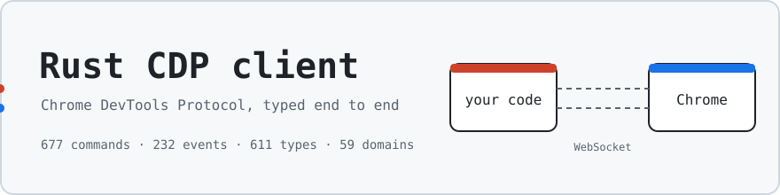
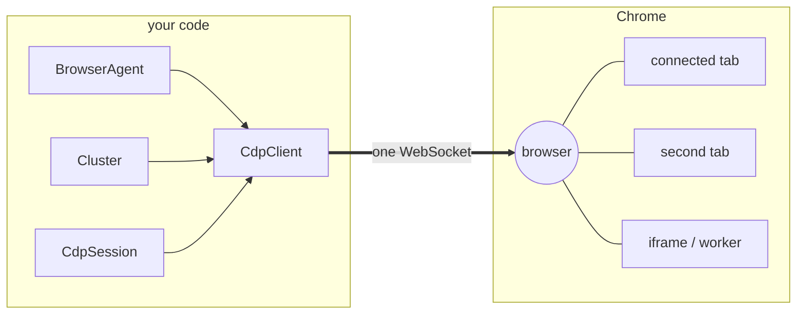
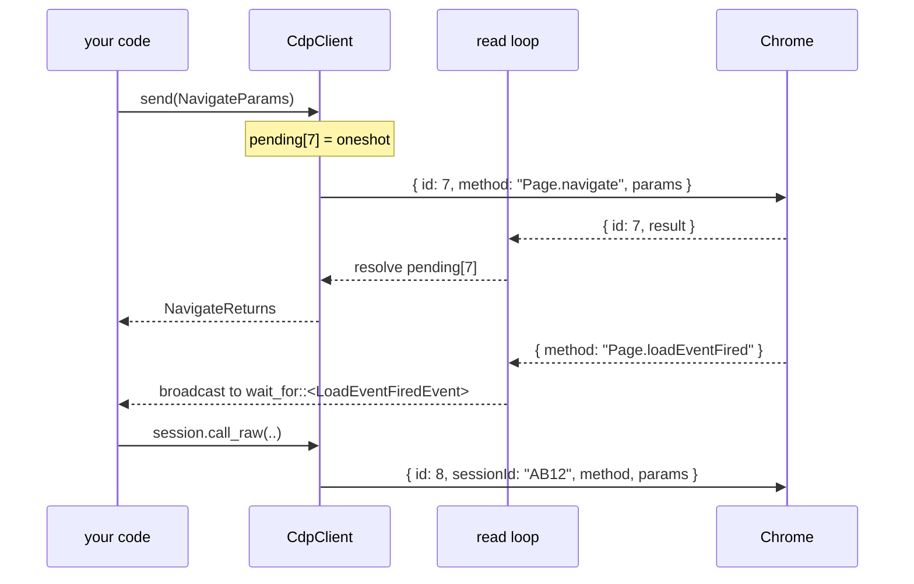
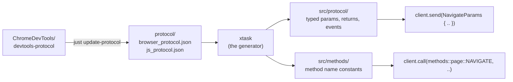

<p align="center">
  
</p>

<h1 align="center">Rust CDP client</h1>

<p align="center">
  <a href="https://crates.io/crates/cdp-driver"></a>
  <a href="https://docs.rs/cdp-driver"></a>
  <a href="https://www.npmjs.com/package/cdp-driver"></a>
  <a href="https://github.com/dreygur/cdp-protocol/actions/workflows/ci.yml"></a>
  
  <a href="LICENSE"></a>
</p>

Chrome DevTools Protocol (CDP) client for Rust, published as `cdp-driver`.
WebSocket browser automation for AI agents, web scraping and testing, with
Node/Deno/Bun bindings over the same core.

All 677 commands, 232 events and 611 types are generated from the published
schema as typed structs. Sessions reach other tabs, iframes and workers over one
connection.

```toml
[dependencies]
cdp-driver = "0.4"
```

## How it talks to Chrome

One WebSocket per client. Every command gets an id; the read loop hands each
reply to whoever is waiting on that id and fans events out to every subscriber.
Commands for an attached tab carry its `sessionId`, so one socket drives many
targets.



A command and the event it triggers, as they move through the client:



`Cluster` is a pool of clients that runs your async tasks across several pages
at once.

## Where the types come from

Nothing in `src/protocol/` or `src/methods/` is written by hand. The generator
reads Chrome's own schema, so a new Chrome release is one command away.



## Workspace

```
crates/
├── cdp-protocol/        # core Rust crate  → crates.io (cdp-driver)
└── cdp-protocol-node/   # napi-rs bindings → npm (Node/Deno/Bun)
protocol/                # vendored CDP schemas the generator reads
xtask/                   # the generator
```

- **[crates/cdp-protocol](crates/cdp-protocol)** the engine: `CdpClient`,
  `BrowserAgent`, `Cluster`. See its README for the full Rust API.
- **[crates/cdp-protocol-node](crates/cdp-protocol-node)** native addon exposing
  the same three classes to JavaScript, Promises + TypeScript types.

## Quick start

Start Chrome with remote debugging:

```bash
google-chrome --headless=new --remote-debugging-port=9222 --no-first-run
```

Rust:

```rust
use cdp_driver::CdpClient;
use cdp_driver::protocol::page::{EnableParams, LoadEventFiredEvent, NavigateParams};

let client = CdpClient::connect_to_page("localhost", 9222).await?;
client.send(EnableParams::default()).await?;

client.send(NavigateParams {
    url: "https://example.com".to_string(),
    ..Default::default()
}).await?;
client.wait_for::<LoadEventFiredEvent>(10_000).await?;
```

```bash
cargo run -p cdp-driver --example basic   # or: agent, cluster, industrial, raw
```

Node / Deno / Bun:

```js
import { BrowserAgent } from 'cdp-driver'

const agent = await BrowserAgent.connect('127.0.0.1', 9222)
await agent.navigate('https://example.com')
console.log((await agent.getTitle()).value)
await agent.close()
```

## Resources

- [Blog: CDP vs WebDriver deep dive](https://dev.to/dreygur/browser-automation-protocols-cdp-vs-webdriver-deep-dive-5bmn)
- [CDP Protocol Viewer](https://chromedevtools.github.io/devtools-protocol/)
- [W3C WebDriver Spec](https://www.w3.org/TR/webdriver2/)
- [Puppeteer Docs](https://pptr.dev/)
- [Playwright Docs](https://playwright.dev/)
